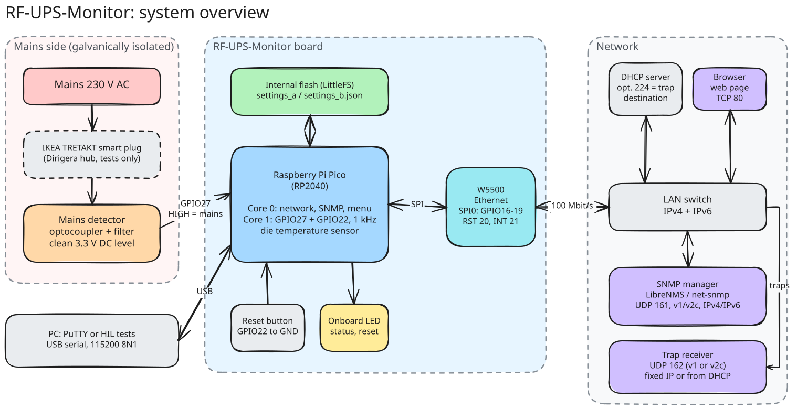
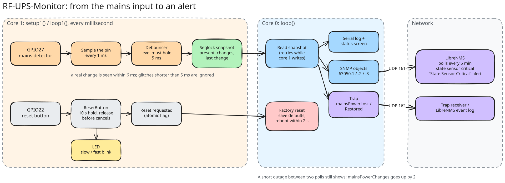
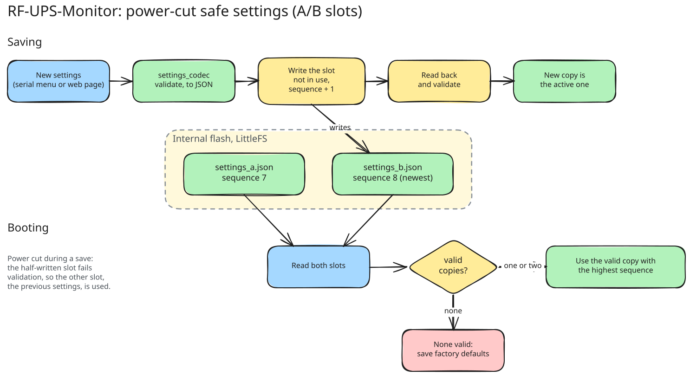
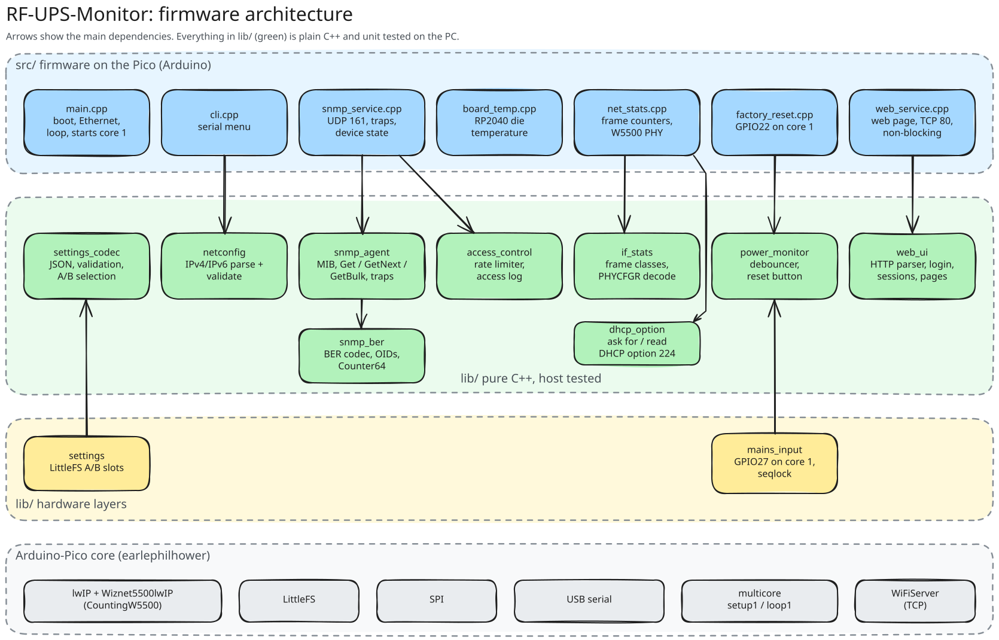
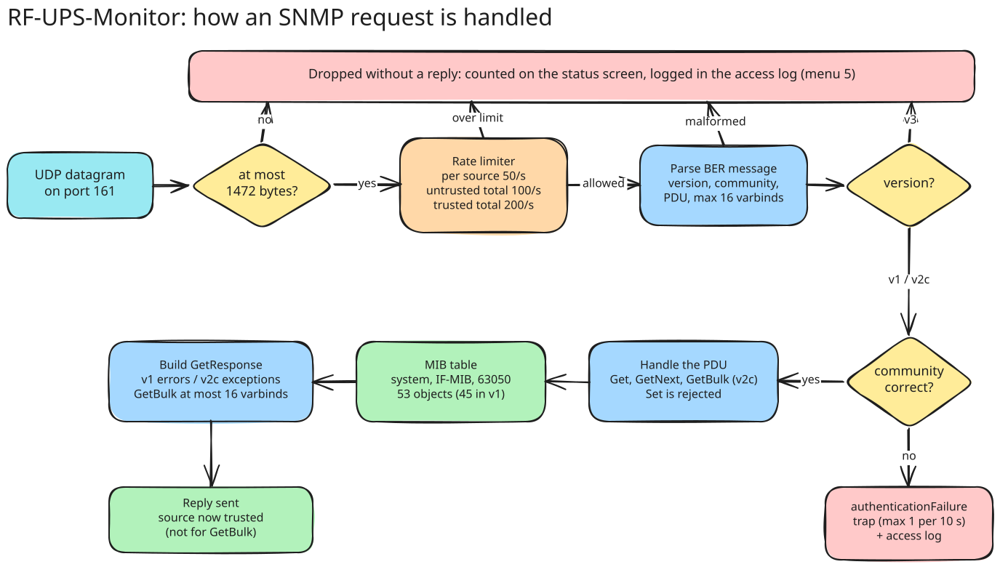

# RF-UPS-Monitor v3

A mains power monitor built on a Raspberry Pi Pico with a W5500 Ethernet module. It reports whether mains power is present over SNMP v1 and v2c, including traps, together with standard interface statistics (IF-MIB) and the board temperature, so it can be monitored by LibreNMS or any other SNMP manager. It is configured through a menu on the USB serial port.

Current version: **2.0.1** (see [CHANGELOG.md](CHANGELOG.md)).

## Overview



- **Mains side:** an isolated detector (optocoupler with filtering) turns mains presence into a clean 3.3 V level on GPIO27. In the test setup an IKEA smart plug in front of it lets the tests switch mains off and on.
- **Board:** the Pico's core 1 samples GPIO27 and the reset button (GPIO22) every millisecond; core 0 runs the network, the SNMP agent and the serial menu. Settings live in the Pico's flash in two copies, and the W5500 provides 10/100 Ethernet over SPI.
- **Network:** the device gets its address by DHCP (or a static IP), answers SNMP v1/v2c on UDP 161 for LibreNMS or net-snmp, sends traps on UDP 162, and serves a configuration web page with login on TCP 80 ([Web page](#web-page)).
- **PC:** the USB serial port carries the configuration menu and the hardware-in-the-loop tests.

More diagrams (firmware architecture, SNMP request flow, mains flow, settings, tests) are in [docs/diagrams/](docs/diagrams/README.md).

## Status

| Feature | State |
|---|---|
| Ethernet with DHCP (default) or static IP | Working |
| Serial menu for network configuration | Working |
| Settings stored in flash, power-cut safe | Working |
| Factory reset button (GPIO22, 10 s hold, non-blocking, LED feedback) | Implemented; manual test with the real button pending |
| Mains power monitoring on GPIO27 (core 1, debounced) | Working, verified with real mains loss/restore (automated with a smart plug) |
| SNMP v1 and v2c agent (Get, GetNext, GetBulk, walk, bulkwalk) | Working, tested with net-snmp |
| SNMP traps in v1 or v2c (coldStart, authenticationFailure, mainsPowerLost/Restored) | Working, mains traps verified with real mains |
| SNMP rate limiting and access log | Working |
| Web page with login: status, DHCP/static IP, SNMP community, restart | Working |
| Interface statistics (IF-MIB ifTable/ifXTable, 64-bit counters) | Working, counted by the firmware |
| Board temperature (RP2040 internal sensor) | Working |
| LibreNMS OS definition (mains state, temperature, change counter) | Working, tested with LibreNMS 26.9.1 |

See [TODO.md](TODO.md) for the detailed plan.

## Documentation

| Document | Contents |
|---|---|
| This README | Hardware, wiring, serial menu, network, mains monitoring, factory reset, settings, building, SNMP overview, troubleshooting |
| [docs/MIB.md](docs/MIB.md) | Every SNMP object (system, IF-MIB, RF-UPS-MONITOR-MIB), traps, v1/v2c differences, rate limiting, errors, limits |
| [docs/LIBRENMS.md](docs/LIBRENMS.md) | Monitoring the device with LibreNMS: install, sensors, alerts, traps, Docker test setup |
| [docs/TESTING.md](docs/TESTING.md) | Test layers, how to run them, automated mains tests with a smart plug, what each suite covers |
| [CHANGELOG.md](CHANGELOG.md) | What changed in each version |
| [docs/diagrams/](docs/diagrams/README.md) | Excalidraw diagrams (editable) of the system, firmware, SNMP, mains flow, settings and tests |
| [.clinerules](.clinerules) | Project and test rules |

## Hardware

- Raspberry Pi Pico (RP2040)
- W5500 Ethernet module on SPI0
- Mains detection circuit on GPIO27 (must be galvanically isolated, 3.3 V max)
- Factory reset push button from GPIO22 to GND
- USB cable for power, flashing and the serial menu

### Pin configuration

All assignments are in [include/pins.h](include/pins.h).

| Pin | Function | Notes |
|---|---|---|
| GPIO16 | W5500 MISO | SPI0 RX |
| GPIO17 | W5500 CS | |
| GPIO18 | W5500 SCK | |
| GPIO19 | W5500 MOSI | SPI0 TX |
| GPIO20 | W5500 RST | Pulsed low at boot |
| GPIO21 | W5500 INT | Interrupt-driven receive |
| GPIO22 | Factory reset | Active low, internal pull-up |
| GPIO27 | Mains power detection | HIGH = power present, internal pull-down |
| LED | Onboard LED | Status / reset feedback |

## Serial menu

Connect to the Pico's USB serial port (`COM16` here) at **115200 baud, 8N1**, with PuTTY or any terminal. The menu appears right after boot, without waiting for the network; a `Network up after ... ms` message follows when the address is obtained. Press `?` and Enter to show the menu again.

```
=== RF-UPS-Monitor Menu ===
1. Show status
2. Use DHCP
3. Set static IP
4. SNMP settings
5. Access log
6. Web password
7. New default web password
?. Show this menu
>
```

**1. Show status** prints the mains power state, the board temperature, the Ethernet link speed, traffic and drop counters, the SNMP counters and settings (community, sysName, sysContact, sysLocation), the configured network mode, the stored static settings, and the live interface: state, MAC, IP, subnet, gateway and DNS.

```
> 1

Mains power: present (22 changes, last change 1053 s ago)
SNMP: 802 packets, 802 responses (get 437, getnext 0, set 0), bad community 0, bad version 0, malformed 0
SNMP v2c: 792 requests, 365 getbulk
Board temperature: 40.4 C
Ethernet: link up, 100 Mbit/s, in 184054263 bytes / 1351415 packets, out 149671 bytes / 1002 packets
Ethernet drops: 0 discarded (no buffer), 0 errors, 211829 unknown protocol, 0 send errors
SNMP security: 0 rate limited, 0 access log events
SNMP community: "public"
sysName: "rf-ups-monitor"
sysContact: ""
sysLocation: ""
Trap destination: "" (4 sent, 0 failed)
Trap version: v2c
Web login: user admin, default password "k7wqz3mtd9" (change with option 6)
Core 0 stack: 2520 bytes never used
Mode: DHCP
Stored static IP: 10.10.6.249 / 255.255.0.0, gateway 10.10.0.1
Live interface:
State: connected
MAC: 1E:B2:CF:4E:A2:2C
IP: 10.10.6.111
Subnet: 255.255.0.0
Gateway: 10.10.0.1
DNS: 10.10.0.1
```

"Unknown protocol" counts frames the device receives but does not use (IPv6, LLDP, spanning tree); on a busy LAN it grows steadily, which is normal.

The interface state line is one of:

| State | Meaning |
|---|---|
| `connected` | Address assigned, device reachable |
| `link up, waiting for DHCP lease` | Cable OK, no DHCP answer yet (keeps retrying) |
| `no Ethernet link, check cable` | No link on the W5500 port |
| `W5500 not detected, check wiring` | The Ethernet module did not respond at boot |

**2. Use DHCP** switches to DHCP after you confirm with `y`.

**3. Set static IP** asks for the IP address, subnet mask and gateway in turn. The value in brackets is the current one; press Enter to keep it.

```
> 3
Press Enter to keep the value in brackets.
IP address [192.168.1.100]: 10.10.6.250
Subnet mask [255.255.255.0]: 255.255.0.0
Gateway [192.168.1.1]: 10.10.0.1

New mode: Static 10.10.6.250 / 255.255.0.0, gateway 10.10.0.1
Save and reboot? (y/n): y
Settings saved. Rebooting...
```

Every value is checked before it is accepted, and a rejected value is asked for again:
- addresses must be four numbers 0-255 (`10.10.6.250`)
- the subnet mask must be contiguous (`255.255.252.0` is fine, `255.0.255.0` is not)
- the IP must not be the network or broadcast address of the subnet
- the gateway must be in the same subnet and differ from the IP

Nothing changes until you answer `y`. Changes are saved to flash and the device reboots to apply them. Answer `n` to cancel.

**4. SNMP settings** asks for the community string, sysName, sysContact, sysLocation and the trap destination in turn. Press Enter to keep the value in brackets, or type `-` to clear a value (for the trap destination: turn traps off).

```
> 4
Press Enter to keep the value in brackets, '-' to clear it.
Community [public]: s3cret
sysName [rf-ups-monitor]: ups-rack4
sysContact []: ops@example.com
sysLocation []: Server room, rack 4
Trap destination IP []: 10.10.6.65
Trap version (1/2c) [2c]:

New SNMP settings: community "s3cret", sysName "ups-rack4", sysContact "ops@example.com", sysLocation "Server room, rack 4", trap destination "10.10.6.65", trap version v2c
Save? (y/n): y
SNMP settings saved and active
```

- Community: 1-31 printable ASCII characters. After saving, requests with the old community get no answer.
- sysName, sysContact, sysLocation: 0-63 printable ASCII characters.
- Trap destination: an IPv4 address that receives traps on UDP 162, or empty for no traps.
- Trap version: `1` (SNMPv1 Trap-PDU) or `2c` (SNMPv2-Trap, default).
- Saved to flash and active immediately, no reboot. A factory reset restores `public`, `rf-ups-monitor`, empty contact and location, no trap destination and v2c traps.

**5. Access log** lists the most recent rejected SNMP requests, newest first: wrong community, SNMPv3, malformed packets, rate-limited sources and SetRequests. Repeats from the same source are counted on one line:

```
Access log: 3 entries, 128 events since boot
  10.10.6.65      rate limited   x104    last 2 s ago
  10.10.6.65      bad version    x1      last 40 s ago
  10.10.6.80      bad community  x23     last 61 s ago
```

Each new entry is also printed on the serial port when it happens (`SNMP access: bad community from 10.10.6.80`).

**6. Web password** sets the password for the web page (see [Web page](#web-page)), or `-` returns to the device default password. The password is asked twice and shown as `*` while typing.

**7. New default web password** replaces the device default password with a new random one after you confirm with `y`, and shows it. Use it if the default password became known to someone else: the old one stops working at once (browsers logged in with it are logged out), and the new one is kept across restarts. An own password set with option 6 stays in use.

If you lock yourself out with a wrong static address, use the serial menu to switch back to DHCP, or do a factory reset.

## Web page

The device serves a small configuration page on **http://&lt;device IP&gt;/** (port 80): log in, see the status, change the network settings and the SNMP community, and restart the device.

- **Login:** user `admin`. Until you set your own password, the password is the device's **default password**: 10 random characters generated on first boot, different for every device, and shown only on the serial status screen (menu option 1): `Web login: user admin, default password "k7wqz3mtd9"`. A factory reset does not change it; menu option 7 replaces it with a new random one.
- **Own password:** serial menu option 6 sets one (8-32 characters, no spaces; typed characters are shown as `*`), or `-` goes back to the device default. Changing it logs every browser out. The password is stored as a salted SHA-256 hash (2000 rounds), never as text; checking it takes about half a second, done in small steps so SNMP keeps answering meanwhile. It can only be changed from the serial menu, so someone who learns it cannot lock you out.
- **Status:** mains power and change count, uptime, board temperature, Ethernet link, IP and MAC address, network mode, firmware version.
- **Network:** DHCP or static IP (address, mask and gateway are checked as in the serial menu). Saving restarts the device; the page tells you the new address.
- **SNMP community:** active immediately, no restart.
- **Restart device** and **Log out** buttons.

Security:
- Five wrong logins in a row lock the login for 30 seconds, from any address. Failed logins and lockouts appear in the access log (menu option 5) as `web login failed` / `web locked out`.
- A session ends after 15 minutes without a request, on Log out, after a restart, or when the password changes. At most two browsers are logged in at once.
- The session cookie is `HttpOnly` and `SameSite=Strict`, every form carries a per-session token (CSRF protection), and the page sends a strict Content-Security-Policy (no scripts at all) and forbids framing.
- **Plain HTTP:** the password and the session cookie cross the network unencrypted, like the SNMP community. Use the page on a trusted management network.
- The server handles one connection at a time without ever blocking: requests are read as they arrive (at most 2 KB), responses are written as fast as the network takes them, and a connection that does not finish within 5 seconds is closed. SNMP keeps answering in between.

## Network

- **DHCP** is the default. The lease is requested in the background, so boot and the menu never wait for it. If no DHCP server answers, the device keeps retrying indefinitely and does not fall back to another address (to avoid IP conflicts). Lease renewal is automatic, and the serial log reports when the address is obtained, changes or is lost.
- **Static IP** is set through the serial menu.
- The MAC address is derived from the Pico's unique chip ID, so it is stable across reboots. Reserve it in your DHCP server for a fixed address.
- Networking uses the Arduino-Pico core's lwIP driver for the W5500 (`Wiznet5500lwIP`).

## Mains power monitoring



GPIO27 reads the mains detection circuit: HIGH = mains present, LOW = mains lost. The internal pull-down is enabled, so a disconnected input reads as "lost" rather than floating.

- Core 1 samples the pin every millisecond and only accepts a new level once it has held for 5 ms, so short glitches and contact bounce are ignored. A real change is detected within 6 ms (requirement: 10 ms).
- Core 0 (network, menu, SNMP) reads the state through a sequence lock, so it never sees a half-updated value and core 1 never waits.
- Every change is logged on the serial port, e.g. `Mains power LOST at 123456 ms`, and the status screen shows the state, the number of changes and the time since the last one:

```
Mains power: present (2 changes, last change 37 s ago)
```

The input must be a clean DC level from an isolated circuit (optocoupler with filtering). An unfiltered optocoupler on AC toggles at 100 Hz and would be read as constant power loss and restore; `pio test -e pico -f embedded/test_mains_input -v` prints the raw toggle rate to check this. On the current hardware it reads 0 toggles/s.

## Factory reset

1. Press and hold the button on GPIO22. The onboard LED blinks slowly (2 Hz) while it is held, and the serial log prints `Factory reset button pressed`.
2. After 10 seconds the LED blinks fast, and the log prints `Factory reset after 10000 ms hold`. You can release the button.
3. Settings return to defaults: DHCP on, community `public`, sysName `rf-ups-monitor`, empty sysContact and sysLocation, no trap destination, and the web page back on the device default password (the default password itself stays the same).
4. The device reboots, well within 2 seconds of the trigger.

Releasing the button earlier cancels the reset (`released after ... ms, no reset`). The device keeps working normally while the button is held: SNMP answers, the menu responds and mains monitoring continues. A button held down while the device starts is ignored until it has been released once, so a stuck button cannot cause a reset loop.

## Settings storage



Settings are stored as JSON on the Pico's internal flash (LittleFS) in two copies, `data/settings_a.json` and `data/settings_b.json`:

```json
{"community":"public","dhcpEnabled":true,"staticIP":"192.168.1.100",
 "subnetMask":"255.255.255.0","gateway":"192.168.1.1","sysName":"rf-ups-monitor",
 "sysContact":"","sysLocation":"","trapTarget":"","trapVersion":2,"webPassword":"",
 "version":1,"sequence":7}
```

| Field | Meaning |
|---|---|
| `community` | SNMP community string, 1-31 printable characters |
| `sysName`, `sysContact`, `sysLocation` | SNMP system group text, 0-63 printable characters; optional, defaults if missing |
| `trapTarget` | IPv4 address that receives traps, empty = no traps; optional |
| `trapVersion` | `1` = SNMPv1 Trap-PDU, `2` = SNMPv2-Trap (default); optional |
| `webPassword` | Salted SHA-256 hash of the web password (`<salt>$<hash>`), empty = device default password; optional |
| `dhcpEnabled` | `true` = DHCP, `false` = use the static fields |
| `staticIP`, `subnetMask`, `gateway` | Static configuration, validated when DHCP is off |
| `version` | Layout version, currently 1 |
| `sequence` | Save counter |

Each save writes the copy that is **not** in use, with `sequence` one higher, and reads it back to check it. At boot the valid copy with the highest `sequence` is used. If the device loses power during a save, the half-written copy fails validation and the previous one is loaded, so settings are never lost. If neither copy is valid, factory defaults are saved.

Files from older firmware (without `sequence`, with an `active_file` pointer) are still loaded, and the pointer file is removed.

The project's `data/` folder is **not** needed: the firmware creates its settings on first boot. Uploading it (`pio run -t uploadfs`) replaces the whole flash filesystem and erases the device's settings.

## Building and flashing

Requirements: VS Code with PlatformIO. On Windows you also need the WinUSB driver on the Pico's boot interface, a one-time step with Zadig described in [docs/TESTING.md](docs/TESTING.md#usb-driver-for-flashing).

```powershell
$pio = "$env:USERPROFILE\.platformio\penv\Scripts\pio.exe"
& $pio run -e pico               # build
& $pio run -e pico -t upload     # build and flash (close PuTTY first)
& $pio device monitor            # serial monitor
```

If upload fails, hold BOOTSEL while plugging in the Pico and copy `.pio\build\pico\firmware.uf2` to the `RPI-RP2` drive.

## Testing

There are three layers: unit tests on the PC, tests on the Pico, and hardware-in-the-loop tests that drive the real serial menu.

```powershell
& $pio test -e native     # PC, no hardware
& $pio test -e pico       # on the Pico (reflash the firmware afterwards)
& "$env:USERPROFILE\.platformio\penv\Scripts\python.exe" -m unittest discover -s test/hil -v
```

Setup, coverage and how to add tests: [docs/TESTING.md](docs/TESTING.md). Rules for test code: [.clinerules](.clinerules).

## Project structure

```
include/pins.h              GPIO assignments
src/main.cpp                Boot, Ethernet bring-up, main loop
src/cli.cpp                 Serial menu
src/factory_reset.cpp       Reset button on core 1, reset on core 0
src/web_service.cpp         Web page on TCP 80: non-blocking connection handling, default password
src/stack_watch.cpp         Core 0 stack high-water mark for the status screen
lib/netconfig/              IPv4 parsing and validation (pure C++)
lib/settings_codec/         Settings JSON, validation, A/B selection (pure C++)
lib/settings/               LittleFS storage on top of settings_codec
lib/power_monitor/          Mains input debouncer, reset button logic (pure C++)
lib/access_control/         Rate limiter and access log (pure C++)
lib/mains_input/            GPIO27 sampler on core 1, seqlock hand-over to core 0
lib/snmp_ber/               ASN.1 BER codec and OIDs for SNMP (pure C++)
lib/snmp_agent/             SNMP v1/v2c messages, MIB, request handling, traps (pure C++)
lib/if_stats/               Ethernet frame counting and W5500 PHY status decoding (pure C++)
lib/web_ui/                 Web page: HTTP parser, login, sessions, pages, SHA-256 (pure C++)
src/snmp_service.cpp        UDP port 161, device state for the MIB
src/net_stats.cpp           Counts frames at the lwIP driver, reads the W5500 PHY register
src/board_temp.cpp          RP2040 die temperature, averaged
mibs/                       RF-UPS-MONITOR-MIB
librenms/                   LibreNMS OS detection and discovery definitions, Docker test setup
test/host/                  Host build of the agent for net-snmp checks
test/native/                Unit tests, run on the PC
test/embedded/              Unity tests, run on the Pico
test/hil/                   Python tests over the serial port
scripts/wait_for_port.py    Waits for the USB port after flashing, for pio test
scripts/sanitize.sh         Native tests under ASan/UBSan (run in WSL)
scripts/host_agent_check.sh Agent against real net-snmp tools, no hardware (run in WSL)
docs/TESTING.md             Test guide
docs/MIB.md                 SNMP objects, traps, errors, limits
docs/LIBRENMS.md            Adding the device to LibreNMS
CHANGELOG.md                Release history
.github/workflows/tests.yml CI: unit tests, sanitizers, net-snmp check, firmware build
```



Pure libraries have no Arduino or hardware dependency so they can be unit tested on the PC. Hardware and file access stay in thin layers on top.

## SNMP

An SNMP agent runs on UDP port 161 and answers SNMPv1 and SNMPv2c, each request in its own version (SNMPv3 is not supported). The community is `public` by default (menu option 4 changes it, along with sysName, sysContact and sysLocation). It supports Get and GetNext, so `snmpwalk` works, and in v2c GetBulk, so `snmpbulkwalk` works too; everything is read-only.

```
.1.3.6.1.2.1.1          system group
  .1.0  sysDescr        .2.0  sysObjectID     .3.0  sysUpTime
  .4.0  sysContact      .5.0  sysName         .6.0  sysLocation
  .7.0  sysServices
.1.3.6.1.2.1.2          IF-MIB interfaces: ifNumber and ifTable for the Ethernet port (index 1)
.1.3.6.1.2.1.31.1.1     IF-MIB ifXTable: ifName, 64-bit ifHC* counters (v2c only), ifHighSpeed
.1.3.6.1.4.1.63050      RF-UPS-MONITOR-MIB (enterprise 63050)
  .1.0  mainsPowerStatus      INTEGER 1 = present, 0 = lost
  .2.0  mainsPowerChanges     Counter32
  .3.0  mainsPowerLastChange  TimeTicks
  .4.0  boardTemperature      Integer32, 0.1 degrees Celsius
```

The interface counters are kept by the firmware: every Ethernet frame the W5500 receives or sends is counted (octets, unicast, multicast, broadcast), since the W5500 in MAC-raw mode has no counters of its own. Link state and speed come from the W5500 PHY register. The board temperature is the RP2040's internal sensor, which reads the chip temperature: a few degrees above the air around it.

To monitor the device with LibreNMS see [docs/LIBRENMS.md](docs/LIBRENMS.md).

```bash
snmpwalk     -v1  -c public 10.10.6.111
snmpbulkwalk -v2c -c public 10.10.6.111
snmpget      -v2c -c public 10.10.6.111 1.3.6.1.4.1.63050.1.0
```

**Traps** go to the trap destination set in menu option 4 (UDP 162), as v2c (default) or v1: `coldStart` at boot, `mainsPowerLost` and `mainsPowerRestored` (with the three mains objects), and `authenticationFailure` for a wrong community (at most one per 10 s).



GetBulk replies hold at most 16 objects, so a small request cannot be used to reflect a large reply at a faked source address.

**Security:** each source address may send 50 requests per second on average, with bursts of 100. Sources that have not shown the right community share a limit of 100 per second, so faked source addresses cannot get around it or starve your managers; managers that use the community share a separate limit of 200 per second. More is dropped and logged. Change the community from `public` (menu option 4): SNMPv1 and v2c have no other authentication. Rejected requests are kept in the access log (menu option 5).

Object details, traps, error behaviour, limits and the MIB file: [docs/MIB.md](docs/MIB.md). The status screen (menu option 1) shows the SNMP counters, rate-limited requests and traps sent.

## Troubleshooting

| Problem | What to check |
|---|---|
| Someone else knows the default web password | Serial menu option 7 makes a new one; or set your own with option 6 |
| Forgot the web password | Serial menu option 6, enter `-` to go back to the device default password shown on the status screen |
| Web page does not load | Use `http://` (not https); the status screen shows the device IP |
| No traps arrive | Trap destination set (status screen shows it and "N sent"); firewall on the receiving PC must allow inbound UDP 162 |
| A manager gets no answers after polling hard | Rate limit (50/s per source): check menu option 5 for "rate limited" |
| No IP address | Menu option 1 shows the state: cable/link, or no DHCP answer (it keeps retrying) |
| Unreachable after setting static IP | Use the serial menu to check or switch back to DHCP, or factory reset |
| Upload fails with "Access denied" | Close PuTTY or the serial monitor |
| Upload fails with "unable to connect" in BOOTSEL | Install the WinUSB driver with Zadig |
| No serial output | Terminal must set DTR (PuTTY does); reset the board |

## Safety

- The mains detection circuit must be galvanically isolated (optocoupler).
- No GPIO may see more than 3.3 V.
- Ground all modules properly.

## License

MIT
