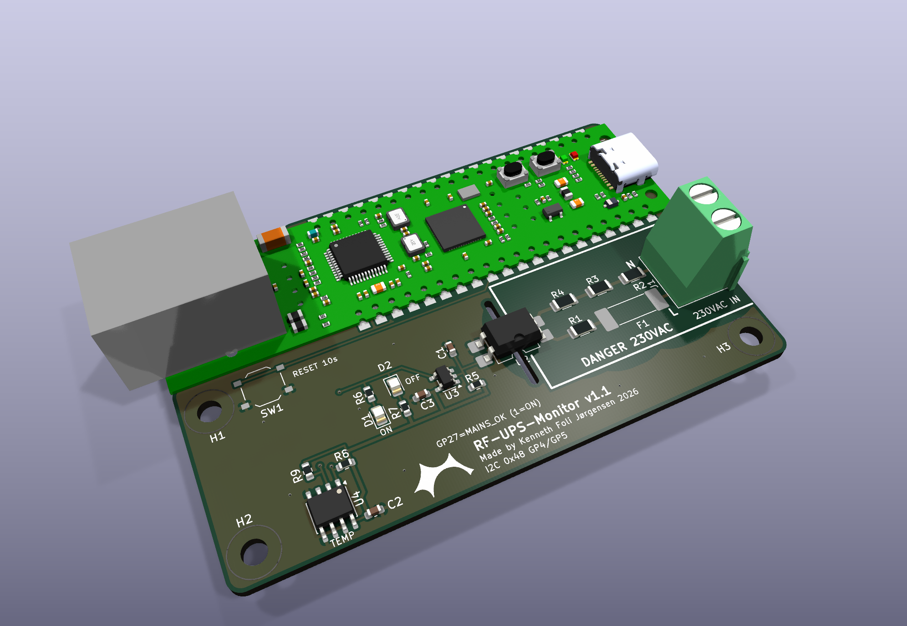
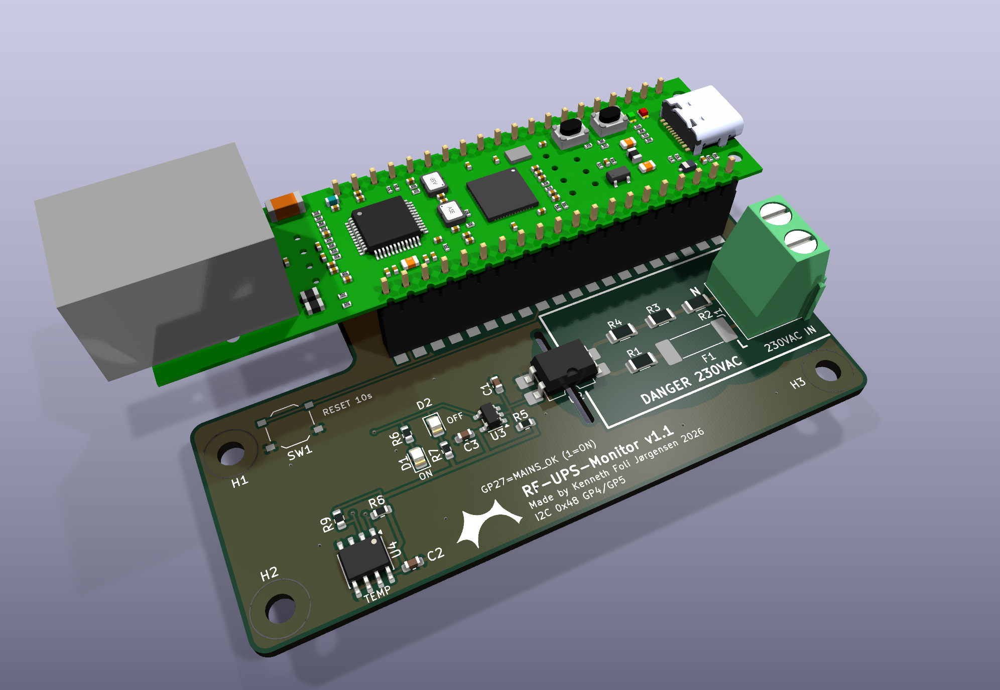
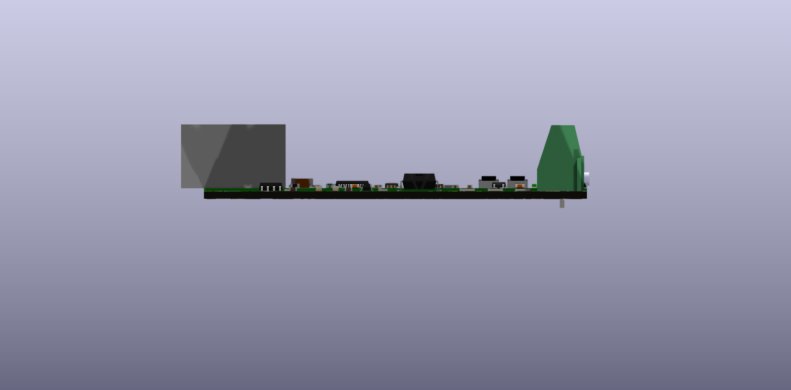
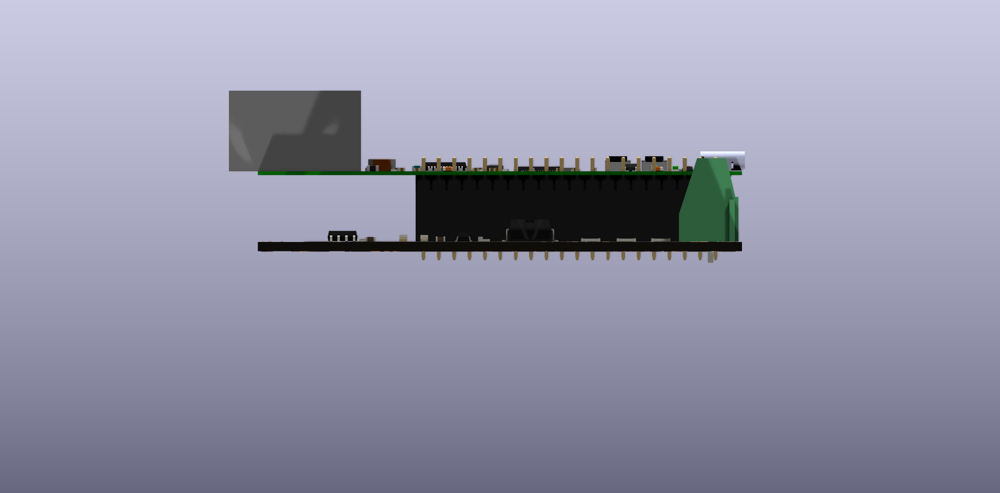

# W5500-EVB-Pico-PoE mains monitor carrier



A 2-layer carrier board for the WIZnet W5500-EVB-Pico-PoE. It is 80 x 51.5 mm: exactly as long as the module, so both short edges line up with the module. The board extends 1.5 mm above the module for the solder fillets. It has 5x M3 holes, with centres at (4, 25.5), (4, 46) and (76, 46) mm from the module's top-left corner, plus H4 (30, 10.5) and H5 (66.5, 10.5) under the module, between the header rows.
All SMD parts are on the top side. The only through-hole parts are the module headers and the screw terminal.

## What it does

| Function | Connection |
|---|---|
| 230 VAC present / absent | **GP27** (module pin 32): HIGH = mains present, LOW = mains absent |
| LED indication (hardware, no firmware needed) | Green D1 = mains ON, red D2 = mains OFF |
| Temperature | TMP1075 on I2C0: **GP4 = SDA, GP5 = SCL**, address **0x48** |
| Factory reset | SW1 from **GP22** (module pin 29) to GND, below the module; hold 10 s (the firmware's internal pull-up holds GP22 high) |
| Power | From the module's 3V3(OUT) pin 36 (the module is PoE powered) |

GP16 to GP21 are used by the on-board W5500 and are not used here.

## Mounting the module

| Soldered flat | On female headers |
|---|---|
|  |  |
|  |  |

You can mount the module in either of two ways; the footprint supports both.

- **Socketed:** two 1x20 female headers (2.54 mm, 8.5 mm high, e.g. LCSC C2905423) in the through-hole pads, and two 1x20 male headers (2.5 mm body) soldered under the module. The module sits 11 mm above the carrier and stays removable. Use all five mounting holes: screw the carrier down through H4 and H5 first (a normal M3 pan or cheese head fits easily), then plug the module in.
- **Soldered flat:** the module's long edges are castellated, and every pin has a pad that reaches 1 mm past the module edge. Solder the castellations directly; no headers are needed. H4 and H5 are covered by the module and stay empty; mount the carrier by H1 to H3.

For flat mounting, the carrier has clearance for the parts that stick out under the module. The positions come from WIZnet's V1.1 drill file.
- A corner notch for the RJ45 pins, posts and shield tabs, and for the PoE module's first 1x4 header (x 20.4 mm).
- A window for the PoE module's second 1x4 header (x 55.0 mm) and the SWD header (x 58.5 mm).
- A notch at the USB end for the USB-C shell and its tabs, which reach 0.37 mm below the module.

Trim any header pins under the module flush before soldering it down.

## Circuit

- 230 VAC goes in on J1 (L/N, 5.08 mm screw terminal on the right edge; the wires enter from the same end as the USB port).
- F1 (Schurter UMT 250, T 100 mA, 250 VAC) follows J1 in L. The mains side is a single series loop (L, F1, R1, optocoupler, R4, R3, R2, N), so F1 carries any fault current on the board, whichever way L and N are wired. It does not replace the upstream fuse.
- Four 68 k 1206 resistors rated 200 V (R1 in L, R2 to R4 in N) limit the current to about 1.2 mA peak, about 50 mW per resistor.
- An LTV-814S AC-input optocoupler (5 kVrms) pulls SENSE low on both half-cycles.
- C1 (1 µF) with R5 (47 k) bridges the zero crossings, so SENSE goes high about 30 to 50 ms after mains is lost.
- A 74LVC1G14 Schmitt inverter produces a clean MAINS_OK signal. It drives GP27 and both LEDs.

## Isolation

The mains area is on the right, below the module's USB end, outlined on silkscreen ("DANGER 230VAC"). The low-voltage logic, LEDs and temperature sensor are on the left. MAINS_OK, +3V3 and I2C reach them on the bottom layer, running between the module's two header rows.

- Mains copper is at least 6.5 mm from everything else, with at least 6.4 mm creepage. Both are enforced as DRC rules in `pico-poe-mains-carrier.kicad_dru`.
- A routed slot under the optocoupler lengthens the creepage path.
- There is no copper pour and there are no vias inside the mains area.
- The mounting holes are well away from the mains area.

## Files

- `pico-poe-mains-carrier.kicad_pro/.kicad_sch/.kicad_pcb`: the KiCad 10 project
- `PicoPoE_Carrier.kicad_sym`, `PicoPoE_Carrier.pretty/`: project symbols and the module footprint
- `fab/`: Gerbers and drill (zip), BOM and CPL in JLCPCB format, schematic PDF, STEP model
- `tools/generate.py`: generates the whole project; `tools/check.sh` runs ERC and DRC; `tools/fab.sh` exports the fab files

## Assembly notes

- Socketed: fit 2x 1x20 female headers (not in the BOM). Flat: solder the castellated edges, no headers needed.
- The module (U1) is excluded from the BOM and CPL.
- F1 has no LCSC part number: order Schurter 3403.0156.11 through JLCPCB's global sourcing or solder it by hand (Mouser, DigiKey). SW1 is LCSC C318884.
- Check the rotation of U2, U3 and U4 in JLCPCB's placement preview before ordering.
- The temperature reading includes some self-heating from the board and module. For true ambient, mount the board vertically or add an offset in firmware.
- Mains wiring must be done by a qualified person. The board must sit in a closed enclosure, and the supply must be fused upstream.

## Firmware

The firmware in this repository (C++, see the [main README](../../README.md)) runs on the module unchanged: it reads MAINS_OK on GP27 (HIGH = mains present) and uses the on-board W5500 on GP16-GP21. It does not read the TMP1075 yet. Its 10 s factory reset reads SW1 on GP22 (active low).

## Firmware sketch (MicroPython)

```python
from machine import Pin, I2C
mains = Pin(27, Pin.IN)
i2c = I2C(0, sda=Pin(4), scl=Pin(5), freq=400_000)
raw = i2c.readfrom_mem(0x48, 0x00, 2)
temp_c = ((raw[0] << 8 | raw[1]) >> 4) * 0.0625   # sign-extend for < 0 C
print("mains", "ON" if mains.value() else "OFF", "temp", temp_c)
```

## Repository layout

```
pico-poe-mains-carrier/
├── pico-poe-mains-carrier.kicad_pro   KiCad 10 project
├── pico-poe-mains-carrier.kicad_sch   schematic
├── pico-poe-mains-carrier.kicad_pcb   PCB
├── pico-poe-mains-carrier.kicad_dru   custom design rules (230 VAC isolation)
├── PicoPoE_Carrier.kicad_sym          project symbol library
├── PicoPoE_Carrier.pretty/            project footprint library (module footprint)
├── sym-lib-table, fp-lib-table        project library tables (paths are relative)
├── fab/                               Gerbers, BOM, CPL, schematic PDF (see fab/README.md)
├── images/                            renders: top, bottom, 3D and side views; module soldered flat
│                                      (iso, side-flat), on headers (*-headers) and carrier only
├── 3d/                                STEP + GLB of the board with the module soldered flat and on
│                                      headers, STEP of the carrier only, and WIZnet's module model
└── tools/
    ├── generate.py                    generates the whole KiCad project
    ├── check.sh                       regenerate + ERC + DRC (needs kicad-cli 10)
    ├── fab.sh                         export the files in fab/
    ├── render.sh                      render images/ and export 3d/
    └── stock_fp/                      copies of the KiCad 10 library footprints used
```

All library paths are relative (`${KIPRJMOD}`), so the folder works anywhere. For example, you can place it at `hardware/pico-poe-mains-carrier/` in your firmware repository. Stock footprints and 3D models come from the standard KiCad 10 libraries.

`tools/generate.py` rewrites the schematic and PCB. If you edit the board by hand in KiCad, either copy the change into `generate.py` or stop using the generator; otherwise your edit will be overwritten.

`3d/W5500-EVB-Pico-PoE_V1.1.step` is WIZnet's 3D model of the module, from https://docs.wiznet.io/Product/Chip/Ethernet/W5500/W5500-EVB-Pico-PoE. The module footprint shows it soldered flat. The cutouts in the carrier match WIZnet's V1.1 drill file.

The footprints in `tools/stock_fp/` are from the KiCad library, licensed CC-BY-SA 4.0 with an exception for designs made with them (https://www.kicad.org/libraries/license/).

